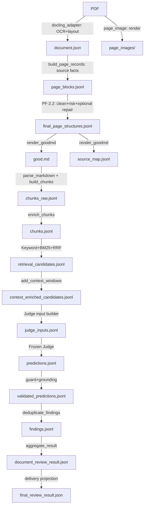
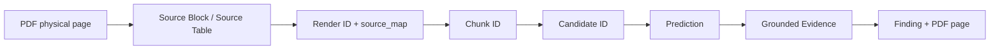

# 招标文件智能审查系统

> 文档状态：【当前实现】；工程名：`tender_review_system`；基线日期：2026-09-14。除明确标注【历史探索】【曾用方案】【规划中】【未来工作】外，本文描述当前真实代码与产物。路径采用逻辑根，不绑定开发机器。

逻辑根约定：`<PARSER_ROOT>` 为解析组件，`<CHUNK_ROOT>` 为切分组件，`<RETRIEVAL_ROOT>` 为召回与证据后处理组件，`<JUDGE_ROOT>` 为冻结审查运行组件，`<PIPELINE_ROOT>` 为本地编排组件，`<OUTPUT_ROOT>` 为运行产物根，`<RULE_STORE>` 为规则库，`<FROZEN_PROGRAM>` 为冻结提示程序。


## 1. 项目目标与交付边界

系统接收一份招标文件 PDF，输出指定审查项的文档级结论、命中原文、PDF物理页码、章节定位、判断原因及可审计来源链。当前交付是单规则、本地顺序执行、云模型接口的技术基线。当前启用规则为 `RP_REGION_INDUSTRY_AWARD`，审查“地域/行业业绩奖项及外部荣誉作为招投标加分、中标条件”。系统已在三份真实PDF上完成端到端技术运行；这证明链路可执行和产物闭合，不等于业务准确率已经达到生产标准。

输出采用 `PASS / FAIL / REVIEW`。`PASS` 表示已审候选未形成违规或需复核事实；`FAIL` 必须有来自解析原文的可定位证据；`REVIEW` 表示技术失败、证据不足、模型与确定性高风险规则冲突或需要人工判断。文档聚合优先级为 `FAIL > REVIEW > PASS`，避免局部失败被多数正常候选掩盖。

## 2. 为什么采用当前架构

【历史探索】早期工程研究过原生PDF文本、MinerU、Section Map、Parse Plan、章节树和内容单元重建，也保留了Marker、PP-Structure等解析器对比材料。它们证明“直接从解析器标签恢复完美章节树”在复杂招标表格、跨页正文和模板化前附表上成本高，且容易把版式推断误当法律原文。

【当前实现】没有采用“PDF直接送审查模型”。原因有四点。第一，整本PDF超长，模型输入成本和上下文不稳定；第二，模型生成的原文和页码不可作为审计事实；第三，解析错误与法律判断错误必须能分别定位；第四，召回层需要可复现的候选排名。因此系统把事实提取、结构修复、召回、审查和证据校验拆开。

Docling负责提供文本、表格、页码和坐标事实。确定性规则负责页眉页脚、表格覆盖重复、正文枚举保护、阅读顺序风险和表格修复范围。VLM只在风险路由命中时处理有限的既有Block ID；它不能创造原文、不能返回范围外ID，也不能成为证据来源。文本忠实度优先于结构完美度：标题不确定时保留为正文，比错误提升为标题并切断上下文更安全。

Markdown被选为Parser与Chunk之间的稳定接口。它便于人读、保留HTML表格、能表达标题硬边界，并允许通过独立 `source_map.jsonl` 保留确定性来源。Chunk层使用事件解析器而不是按空行粗切，分别构建TEXT和TABLE，避免表格业务行与正文相互吞并。

召回采用Keyword、BM25和Weighted RRF。当前数据量和单规则POC不需要引入向量库、Embedding或Cross Encoder；混合词法召回更容易解释、复现和审计。规则库的违规例、合法边界与扫描范围被编译成多个查询；Keyword权重1.0、risk query权重1.0、boundary query权重0.5，RRF的 `k=60`，最终取Top50。上下文只在排名后扩展，不能反向改变anchor排名。

Judge只看Top-K，因为全书直接审查会显著增加输入长度、重复判断和成本。页码来自Chunk provenance，绝不采用模型自报页码。模型判FAIL时，违规原文必须能匹配到anchor或上下文Chunk；无法ground的FAIL转为REVIEW。模型判PASS但命中高风险触发条件时，同样转为REVIEW。

## 3. 当前生产链路

```mermaid
flowchart LR
  A[Original PDF] --> B[Docling]
  B --> C[Source Fact Layer]
  C --> D[Deterministic Cleaning]
  D --> E[Structure Recovery]
  E --> F[Risk Detection]
  F -->|eligible only| G[Optional VLM Repair]
  F -->|no risk| H[Good Markdown]
  G --> H
  H --> I[Markdown Event Parser]
  I --> J[TEXT / TABLE Chunk]
  J --> K[Provenance Enrichment]
  K --> L[Rule Store]
  L --> M[Keyword + BM25]
  M --> N[Weighted RRF Top-K]
  N --> O[Context Builder]
  O --> P[Frozen Judge]
  P --> Q[Output Guard]
  Q --> R[Evidence Grounding]
  R --> S[Chunk / Page Mapping]
  S --> T[Finding Dedup]
  T --> U[Document Aggregation]
  U --> V[Final JSON + HTML]
```



代码对应关系：`<PIPELINE_ROOT>/review_pipeline/orchestrator.py` 的 `PipelineOrchestrator.run_document()`按 input、docling、parser、chunk、retrieval、judge、finalize 顺序执行。Docling适配在 `docling_adapter.py`；Parser由 `parser_adapter.py` 调用 `<PARSER_ROOT>/docling_postprocess/pf2_pipeline.py`；Chunk调用 `<CHUNK_ROOT>/run_md_chunking.py` 与 `run_c11_closure.py`；召回调用 `<RETRIEVAL_ROOT>/run_candidate_retrieval.py`；Judge调用 `<JUDGE_ROOT>/src/v03_pilot5/run_frozen_prompt_judge.py`；R2证据后处理调用 `<RETRIEVAL_ROOT>/run_r2_pipeline.py`；最终HTML由 `<PIPELINE_ROOT>/review_pipeline/report.py` 生成。

## 4. Parser：事实、清理与结构恢复

### 4.1 Docling事实层

`<PIPELINE_ROOT>/review_pipeline/docling_adapter.py` 配置 `do_ocr=True`、`do_table_structure=True`，RapidOCR后端固定为ONNX Runtime，中文识别，CPU线程数4。转换完成后输出 `document.json` 和初始 `document.md`。当前策略会在整本转换完成后写文件，因此大PDF解析期间临时目录可能暂时为空。

`<PARSER_ROOT>/docling_postprocess/page_blocks.py` 的 `build_page_records()`将Docling对象转换成逐页Source Fact。TEXT Block ID形如 `P0038-B004`，TABLE ID形如 `P0017-T001`。每条记录保存页码、bbox、parser label、原文、表格HTML、furniture状态和covered状态。`_covered_by_table()`通过父引用、几何重叠和表格cell文本判断正文是否已由表格承载，防止同一文字既作为table又作为paragraph出现。

### 4.2 Furniture Repair

`<PARSER_ROOT>/docling_postprocess/furniture.py` 的 `repair()`按当前文档独立学习页眉页脚，不依赖固定字符串或固定像素。它综合原生furniture标签、相邻碎片、跨页重复、归一化垂直位置、奇偶页重复率和隔离间距。没有足够证据时保留正文。该设计解决页眉长度、位置和拆分粒度随文件变化的问题。

### 4.3 active block

`active_blocks()`排除已确认furniture以及 `COVERED_BY_TABLE` 的重复文本。active block是后续结构判断和渲染的唯一候选集合。VLM返回covered或未知ID时，Schema校验失败，不能重新引入已排除内容。

### 4.4 Heading与正文枚举保护

`heading_decision()`采用高精度规则识别章、节、部分标题和有限编号标题。Parser原始 `section_header` 只作为弱证据。`detect_structural_enumeration_runs()`识别连续正文枚举；PF-2.1据此修复page29将“第一章、第二章……”正文清单误判为Heading的问题。策略是Heading Precision优先，普通深层条款在不确定时保留为正文。

### 4.5 Reading order与Table风险

`detect_order_risk()`检测重复、未知、bbox交叉、多栏或孤立编号等风险。`detect_table_risk()`检测空表、表格与正文交错和疑似破损表。正常页面走确定性顺序；风险页面才进入VLM router。

### 4.6 Table Repair Scope Guard

`build_table_repair_scope()`用表格组、横向重叠、邻接距离和高置信Heading边界建立eligible ID集合。`validate_table_repair_scope()`拒绝范围外ID、重复消费source、没有table source的修复。page142曾因一个空表附近存在大量正文而发生范围过扩；PF-2.2最终把该页判为unrepairable并保留确定性原文，不调用不安全修复。`P0142-T001`标记为 `EMPTY_NONCONTENT_TABLE`，由Chunk闭合报告解释性登记，不生成业务Chunk。

### 4.7 VLM边界

`run_pf1()`分别处理order/table任务。动态Schema只枚举当前eligible ID。模型可以返回已有Block ID的顺序、类型或表格归属，但不能重写Block文本。`validate_order()`要求ID集合完整且唯一；`validate_table()`要求source不复用且不越界。API异常、非法JSON、长度截断或Schema错误均保留raw response和validation errors，最终回退确定性结果。

### 4.8 Good Markdown与Source Map

`render_goodmd()`按final page structure渲染Heading、Paragraph和HTML Table。`good.md`不插入调试页标签；`good_debug.md`保留页码和ID便于人工核查。`source_map.jsonl`记录每个render区间对应的source block/table、物理页和语义类型。100% source traceability表示每个active source要么被业务内容消费，要么被明确登记为非内容结构；它不表示标题语义百分之百正确。

## 5. Chunk设计

`parse_markdown()`把Markdown解析成HEADING、TEXT、TABLE事件，保持原始顺序并拒绝未闭合table。Heading是Hard Boundary，只更新上下文，不单独形成内容Chunk。TABLE也构成Hard Boundary，不能与前后正文合并。

当前 `Limits` 为target 1000、soft max 1400、hard max 1800、minimum 300字符。TEXT优先在句号、问号、分号或换行附近切分；没有自然边界才强切并标记。minimum不是全局保证：Heading、TABLE、文档结尾或合并后超过hard max时允许短Chunk。`MERGEABLE_SHORT`是警告，表示仍存在理论可合并短块，不是内容丢失。

`parse_html_table()`展开rowspan/colspan，`serialize_row()`将业务行序列化为稳定文本。长cell按target/hard max分段并重复表格身份字段，使每段仍可理解。空白表、纯空cell表登记为非内容；header-only table仍视为内容。C1建立基础Chunk，C1.1补齐heading context provenance、空表登记和pending heading事件。阶段报告显示C1.1没有改变当时冻结Chunk SHA，变化集中在provenance闭合与报告。

`enrich_chunks()`用source line range与 `source_map.jsonl`建立content provenance；`build_heading_context_assignments()`把前置Heading的source IDs、render IDs和文本作为heading context provenance附加。二者必须分开：正文证据不能借用标题source，标题又必须可追溯。

## 6. Retrieval设计

`compile_rule_store_config()`只选择请求的review item，并校验leaf没有跨审查项混入。当前规则包含12个leaf和7条边界。查询分为基础query、risk query和boundary query，合法例去重后进入边界上下文。`_retrieval_text()`拼接heading path、heading context和chunk text并去重标题；TOC region不进入语料。

Keyword按风险词组和组合条件打分；BM25用中文分词、自定义术语和每个query独立排名；`fuse()`计算 `sum(weight/(60+rank))`，保留原文、页码和source provenance。Top50中TABLE与TEXT同等参与，因为评分表和资格前附表常把关键条件放在表格中。

`add_context_windows()`在排名后建立anchor、context_before、context_after。anchor是被召回和排名的Chunk；context用于补齐跨块语义。完整表格通常不扩展邻居，短文本或配置允许的表格可扩展。Context不重新参加排名，避免相邻噪声改变候选身份。

## 7. Judge与证据闭环

Judge输入只有 `review_item`、`rule_context`、`document_text` 三个模型字段。冻结程序由 `<FROZEN_PROGRAM>`加载，不再执行提示优化。当前真实运行配置：模型 `qwen3-8b`、temperature 0、max tokens 1024、thinking false；低于1024会被运行器拒绝。配置通过OpenAI-compatible endpoint读取，密钥只用 `<YOUR_API_KEY>`占位。

`build_messages()`把冻结指令与三个字段组成请求；`parse_frozen_output()`兼容冻结输出格式；`build_business_output()`输出片段原文、审查结果、违规原文、判断理由和原文行号。raw prediction随后进入R2。

`validate_prediction()`执行Output Guard与High-risk Validation。FAIL的违规原文必须由 `map_evidence()`在候选anchor/context中找到；匹配后页码、source block/table和heading path从Chunk回填。相同文本出现在多个Chunk时，anchor优先，其次按候选上下文顺序；没有精确或空白容忍匹配时，不猜页码。未ground的FAIL和高风险漏判均转换为REVIEW。

`deduplicate_findings()`按标准化证据和共享source去重；`aggregate_result()`执行FAIL、REVIEW、PASS优先级。最终输出 `findings.jsonl`、`document_review_result.json` 和面向交付的 `final_review_result.json`。`final_review_report.html`将Top50召回片段、规则、页码、章节、逐条结论、证据和原因合并展示。

## 8. 数据与产物流转



## 9. Provenance与页码



physical PDF page是文件从1开始的物理页，不换算印刷页码。Source ID标识解析事实；Render ID标识GoodMD中的输出片段；Chunk ID标识召回单元；Candidate ID把rule与rank绑定；Prediction保留候选身份；Finding只能引用grounded evidence。`page_numbers`来自content provenance，heading provenance单独保存。该链是甲方审计的核心。

## 10. Gate与失败语义

Parser Generic Gate检查正页数、active页、source覆盖、missing/duplicate/unknown为零、covered leak为零、VLM失败安全回退、GoodMD和source map有效。Chunk Gate检查非空、页码、source、四类覆盖率和provenance。Retrieval Gate检查TOC排除、Top-K等于可用数量上限、ID唯一、原文不变、页码/source完整、Judge输入数一致。Judge Gate检查每个输入都有prediction、技术失败显式、技术失败不变PASS、FAIL全部ground、页码存在、去重和文档聚合有效。任一Hard Gate失败，orchestrator立即终止并写FAILED summary。

DOC011 Regression Gate只验证固定基线：172物理页、169 active页、1946 source IDs、273 chunks（230 TEXT、43 TABLE）、Top50。它不能应用于其他PDF。Generic Gate不规定固定页数、Block数或Chunk数，只验证闭合和一致性。

## 11. 本地运行

### 11.1 环境

当前Windows验证环境分离：Docling环境使用Python 3.11.16、Docling 2.126.0、ONNX Runtime 1.30.0；Parser后续、Chunk、Retrieval、Judge与Pipeline使用Python 3.12.10。已探测到DSPy 3.3.0、jieba 0.42.1；阶段R1报告记录rank-bm25 0.2.2。Linux尚未验证，状态为UNVERIFIED。

### 11.2 API变量

Parser使用 `PARSER_VLM_API_BASE`、`PARSER_VLM_API_KEY`、`PARSER_VLM_MODEL`、`PARSER_VLM_TEMPERATURE`、`PARSER_VLM_MAX_TOKENS`、`PARSER_VLM_ENABLE_THINKING`、`PARSER_VLM_CONCURRENCY`。Judge使用 `MODEL_API_BASE`、`MODEL_API_KEY`、`MODEL_NAME`、`MODEL_TEMPERATURE`、`MODEL_MAX_TOKENS`、`MODEL_TIMEOUT_SECONDS`、`MODEL_MAX_RETRIES`、`MODEL_ENABLE_THINKING`。密钥示例只能写 `PARSER_VLM_API_KEY=<YOUR_API_KEY>` 与 `MODEL_API_KEY=<YOUR_API_KEY>`。

### 11.3 PowerShell命令

```powershell
Set-Location "<PIPELINE_ROOT>"
$python = "<JUDGE_ENV>/Scripts/python.exe"
$pdf = "<INPUT_ROOT>/new_tender.pdf"

& $python -m review_pipeline.cli `
  --pdf $pdf `
  --rule-id RP_REGION_INDUSTRY_AWARD `
  --check-only

& $python -m review_pipeline.cli `
  --pdf $pdf `
  --rule-id RP_REGION_INDUSTRY_AWARD `
  --resume
```

省略document ID时使用PDF SHA256前8位生成 `DOC_<HASH8>`。DOC011回归增加 `--document-id DOC011 --regression-profile DOC011`。阶段排错使用 `--stop-after input|docling|parser|chunk|retrieval|judge`。Batch使用 `python -m review_pipeline.batch --manifest <BATCH_MANIFEST> --rule-id RP_REGION_INDUSTRY_AWARD --resume`。所有参数均来自当前CLI。新机需要先获取五个逻辑根源码、创建两个Python环境、安装各requirements、准备规则库与冻结程序、创建两份脱敏env、修改 `pipeline.local.yaml` 的本地路径，再执行check-only。

### 11.4 Resume

每个Stage保存input fingerprint、stage code fingerprint、config fingerprint和artifact列表。四者一致才SKIPPED；缺产物或指纹变化则重跑。Judge另保存输入、冻结程序、Judge代码和env文件哈希；变化时清除旧prediction，避免不同输入混合。恢复必须使用同一PDF和同一document ID。

## 12. Multi-PDF真实基线

| 文档 | 页数 | Parser VLM | Chunk | Top-K | Validated | 结论 | Fresh耗时 | 费用 |
|---|---:|---:|---:|---:|---|---|---:|---:|
| DOC011 | 172 | 2次/9242 tokens | 273 | 50 | 48 PASS/2 REVIEW | REVIEW | 主成功链约1413秒；此前含失败重试 | ¥0.119428 |
| DOC_NEW001 | 53 | 1次/4083 tokens | 103 | 50 | 50 PASS | PASS | 457.551秒 | ¥0.119167 |
| DOC_DF323AC6 | 362 | 1次/5966 tokens | 501 | 50 | 40 PASS/4 FAIL/6 REVIEW | FAIL | 1632.187秒 | ¥0.133991 |

DOC011与DOC_NEW001的当前summary后来被resume刷新成毫秒级，不能作为fresh性能；上表DOC011按日志中最终成功阶段累计，DOC_NEW001保留首次fresh summary。DOC_DF323AC6为完整fresh run，其中Docling 1186.085秒、Parser 62.667秒、Chunk 1.817秒、Retrieval 2.053秒、Judge 379.529秒。主要瓶颈是整本Docling OCR与固定50次Judge调用。

## 13. DOC011 R2基线与协会推荐案例

DOC011 Top50的raw结果全部PASS。Output Guard发现两条候选包含“境外企业应是所在国家或地区建筑设计行业协会或组织推荐会员，推荐名单由建设单位确认”，而模型理由仍判断合法，触发 `HIGH_RISK_TRIGGER_MISSED`。两条prediction转为REVIEW，按共享source去重成一个文档复核项，最终Document Result为REVIEW。此案例说明技术闭环完成不等于业务准确率生产可用，也说明高风险保护不能被模型多数PASS覆盖。

## 14. 真实失败案例与最终原则

- Header fragment重复：解析器把同一页眉拆成多块；按文档重复、位置和邻接链修复，原则是不按固定长度裁边。
- bbox reading-order交叉：page127视觉顺序与初始顺序不一致；只允许VLM重排既有ID，原文不变。
- 表格文本重复：正文Block同时落入table cell；标记COVERED_BY_TABLE后从active集合排除。
- page29 enum false heading：连续枚举被错误提升；Body Enumeration Guard确定性降级。
- page74 broken table：风险路由触发表格修复，eligible scope内采用结果。
- page142 empty table与过扩：`P0142-T001`登记为非内容空表；范围无法安全界定时unrepairable并跳过API。
- page142 consecutive heading provenance：B010/B011作为pending heading context交给后续内容，不制造空Chunk。
- 协会推荐漏判：raw PASS命中高风险规则，转REVIEW。
- 0分或停用模板：规则上下文要求按实际生效状态判断，禁止因模板存在即判违规。
- “合同创优”等合同履行要求：需先判断是否作用于投标准入、评分或中标，属于仍需人工金标准覆盖的Rule Scope问题。

## 15. 当前限制与路线

Parser仍受Docling reading order、复杂跨页table、扫描质量、跨页句子和OCR影响。VLM只修结构，不保证语义树完美。Retrieval的Section applicability仍主要靠scan scope和词法信号；Keyword/BM25可能漏掉隐式表达或召回模板噪声。Judge存在False Positive、False Negative、停用模板、合同阶段范围和规则边界问题。Pipeline当前Windows-first、云API、单规则POC、顺序执行；Parser并发配置当前为1，Judge按候选顺序运行。

CURRENT：单规则、本地端到端、三PDF技术基线、可追溯JSON与HTML。NEXT：建立人工Gold、Rule Applicability、Judge精确率/召回率评估、5至10份PDF fresh baseline、形成交付候选。LATER：扩展27类审查规则、Web/API服务、私有模型评估与私有部署。

【未来工作】客户端已通过OpenAI-compatible endpoint隔离模型服务，因此可把云端点替换为本地推理服务。最终模型选型、GPU sizing、量化、vLLM/SGLang生产部署均尚未完成，不能写成当前能力。

## 16. 验收与复现Checklist

- [ ] 两个Python环境版本符合记录并安装requirements。
- [ ] Parser和Judge环境变量齐全，密钥未进入日志。
- [ ] Rule Store与冻结程序路径存在。
- [ ] `--check-only` 返回PASS且 `api_calls=0`。
- [ ] 新PDF输出document.json、page_blocks、good.md和source_map。
- [ ] Parser Generic Gate全部Hard Check通过。
- [ ] chunks.jsonl非空且provenance闭合。
- [ ] Top-K数量等于 `min(50, corpus)`。
- [ ] Judge输入与prediction一一对应，无静默技术失败。
- [ ] 每个FAIL evidence grounded且页码来自Chunk。
- [ ] final_review_result.json与final_review_report.html存在。
- [ ] DOC011回归符合172/169/1946/273/230/43/50。
- [ ] fresh耗时与resume耗时分别记录。

## 17. 分阶段运行契约

### 17.1 Input Stage

输入是用户指定PDF。Pipeline计算SHA256并派生默认document ID，将源文件复制到隔离的 `00_input/source.pdf`。Gate同时验证文件存在和复制前后SHA一致。该副本使后续步骤不受原路径移动影响，也是Resume判断的第一层事实。不同PDF不得复用同一手工document ID；即使文件名相同，只要SHA不同也应形成新的运行身份。

### 17.2 Docling Stage

输入是隔离后的source.pdf，输出是document.json和初始document.md。该阶段执行OCR、layout和table structure，不调用Parser VLM。当前实现先完成整本convert再落盘，因此不能按页恢复；失败后会重跑整个Docling Stage。Gate当前确认document.json存在，内容级完整性由下一阶段Parser Gate承担。对于362页真实文件，该阶段占1186.085秒，是当前最大单项瓶颈。

### 17.3 Parser Stage

输入是source.pdf与document.json的组合指纹。A1先离线生成page_blocks、page images、furniture decisions；PF-2.2再生成风险与scope，选择性调用VLM，逐页持久化page state，最后渲染good.md与source_map。Parser失败不能进入Chunk。VLM失败不是自动的Parser失败：只要非法结果未采用、确定性fallback完整且source覆盖闭合，Gate可以PASS。这样把外部模型波动限制在结构质量，而不是数据丢失。

### 17.4 Chunk Stage

输入指纹来自good.md与source_map。Stage重跑前由orchestrator删除旧chunks_raw、chunks和parse_events，避免新GoodMD与旧Chunk混合。第一入口构建事件与raw chunks，第二入口执行C1.1 provenance closure。Hard Gate要求每个业务Chunk有页码和source；可解释空表必须进入skipped registry。警告不会阻断流水线，但会进入summary或质量报告。

### 17.5 Retrieval Stage

输入是冻结chunks SHA与单规则配置。Rule Store编译器只抽取当前review item；召回器建立去除TOC后的corpus，分别运行Keyword和多query BM25，再用RRF融合、去重、截Top-K并扩展context。candidate anchor正文保持原Chunk文本，便于后续exact grounding。Gate校验unknown ID为零、rank连续、Top-K数量正确、Judge inputs与候选一一对应。

### 17.6 Judge Stage

输入指纹包括judge_inputs、Frozen Program、Judge代码和env配置文件哈希。运行器支持候选级断点续跑；指纹变化时Pipeline清理旧prediction和raw response，防止不同程序或输入混合。每个调用保存usage、latency、raw output和technical error。R2随后完成三分类、grounding、页码映射、dedup和document aggregation。技术错误必须显式保留并转REVIEW，不能被记为PASS。

### 17.7 Finalize Stage

最终Stage复制业务JSON到文档根目录，并把candidate_top50、raw prediction和validated prediction合并成HTML。HTML展示规则全文、召回片段、送审上下文、章节、页码、命中词、模型理由和保护后结论，可筛选PASS/FAIL/REVIEW。Finalize不调用模型，报告缺失时可单独重建。

## 18. 引用条款、补正表与跨页内容的当前处理

Chunk Builder通过 `reference_candidates()`记录“详见、参见、按第某条”等引用候选，也通过“补正、修改表、更正表、澄清表”等词识别特殊内容。这些字段当前用于保留线索和召回文本，并没有实现通用的远距离引用图或“原条款被补正条款覆盖”的Override引擎。相邻上下文扩展只能补齐附近Chunk；跨章节引用仍依赖该目标条款自身被Keyword/BM25召回。

表格在Parser中保留HTML和source table ID，在Chunk中按业务行序列化；相邻页内容可以通过page_numbers与context同时送审。当前没有承诺所有跨页表格都恢复成一个物理HTML表，也没有把补正表自动改写回原条款。法律审查时若原条款与补正文同时召回，Judge可以看到两段，但最终生效关系仍是下一阶段Rule Applicability与Override设计范围。文档明确保留此限制，避免把“线索可检索”误写成“语义覆盖已完成”。

## 19. 运行审计与版本管理

一次可复现运行至少归档source.pdf的SHA、pipeline manifest、config fingerprint、Stage code fingerprints、Rule Store版本、Frozen Program SHA、原始predictions、validated predictions、usage和最终结果。`pipeline_summary.json`适合浏览，不足以独立复现；完整证据在manifest与各Stage报告。对已有运行再次resume会刷新部分状态和耗时，因此fresh manifest应在版本验收时另存不可变副本。

版本升级必须说明变更属于事实提取、结构、Chunk、召回、Judge还是保护层，并选择相应回归集。Parser变更至少复测page29/74/127/142和多PDF Generic Gate；Chunk变更复测SHA、空表和heading provenance；Retrieval变更保存Top50 diff；Judge变更重新评估Gold，不能只看API成功率。

安全方面，日志写入前执行疑似API key脱敏；env文件不得复制到报告、raw response或交付文档。check-only只检查变量是否配置，报告仅写CONFIGURED/MISSING。任何排障命令都不应打印env全文。

## 20. 如何解释最终结果

`PASS`是当前审查项在已召回范围内没有形成FAIL或REVIEW，不代表招标文件所有法律问题均通过。`FAIL`表示至少一个经过grounding的违规发现，原文、Chunk和页码可追溯。`REVIEW`表示系统主动保留不确定性，常见来源是高风险漏判、技术失败或证据不足。最终HTML中的50条卡片是审查过程证据，根目录JSON是文档级交付结论；两者应共同归档。

对于DOC_DF323AC6，raw为40 PASS/10 FAIL，经保护后变为40 PASS/4 FAIL/6 REVIEW。这说明6个raw FAIL没有直接作为确认违规输出，而是因grounding或保护条件转入复核。对于DOC011，raw 50 PASS中有2个因高风险漏判转REVIEW。两种方向共同体现Output Guard：既不接受无证据FAIL，也不接受明显高风险的静默PASS。

## 21. 结论

当前系统已经形成从PDF到审查结果的可运行、可恢复、可审计单规则链路。事实原文由解析器保存，结构修复受到eligible ID与Schema约束，Chunk与召回保留provenance，Judge输出经高风险与grounding保护后聚合。三份真实PDF证明技术链路跨文档可执行；投入生产前仍需人工Gold与更多规则、更多文件的业务评测。
