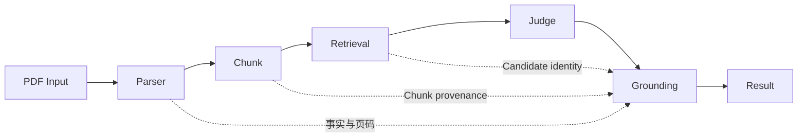

# 招标文件智能审查系统

> 文档状态：【当前实现】；工程名：`tender_review_system`；基线日期：2026-09-14。除明确标注【历史探索】【曾用方案】【规划中】【未来工作】外，本文描述当前真实代码与产物。路径采用逻辑根，不绑定开发机器。

逻辑根约定：`<PARSER_ROOT>` 为解析组件，`<CHUNK_ROOT>` 为切分组件，`<RETRIEVAL_ROOT>` 为召回与证据后处理组件，`<JUDGE_ROOT>` 为冻结审查运行组件，`<PIPELINE_ROOT>` 为本地编排组件，`<OUTPUT_ROOT>` 为运行产物根，`<RULE_STORE>` 为规则库，`<FROZEN_PROGRAM>` 为冻结提示程序。

## 1. 系统逻辑架构

解析负责“原文是什么、在哪一页”，审查负责“该原文是否符合规则”。两者之间通过Good Markdown、Source Map和Chunk契约连接。任何模型输出均不能覆盖Source Fact。

## 2. 核心设计决策

### ADR-001 解析与审查分离
**Context**：整本PDF结构复杂，法律判断需要稳定证据。**Decision**：Parser、Retrieval、Judge独立。**Alternatives**：PDF直接送模型。**Reason**：可定位错误、节省上下文、支持复现。**Consequences**：增加中间Schema，但每层可Gate。

### ADR-002 Docling作为基础解析
**Context**：需要文本、表格、bbox、页码。**Decision**：Docling+OCR为事实入口。**Alternatives**：原生文本、MinerU、Marker、PP-Structure。**Reason**：当前真实文件上表格与provenance更适合作为统一底座。**Consequences**：需修复其reading order和label误差。

### ADR-003 VLM只修结构不生成法律原文
**Context**：生成式文本不能作为证据。**Decision**：只返回eligible Block ID的顺序/角色/归属。**Alternatives**：让模型重写整页Markdown。**Reason**：保证Text Fidelity。**Consequences**：复杂页面可能保守回退。

### ADR-004 Heading Precision优先
**Context**：误Heading会切断上下文。**Decision**：只提升高置信标题，深层编号默认正文。**Alternatives**：追求标题召回。**Consequences**：部分小标题不进入树，但正文连续。

### ADR-005 Markdown作为Chunk接口
**Context**：Parser和Chunk需要可读稳定契约。**Decision**：Good Markdown+Source Map。**Alternatives**：直接把Parser JSON交给Chunk。**Consequences**：便于人工验收，需维护sidecar provenance。

### ADR-006 TEXT/TABLE分离Chunk
**Context**：表格行语义和正文不同。**Decision**：TABLE硬边界、独立序列化。**Alternatives**：统一纯文本切分。**Consequences**：召回同时索引两种类型。

### ADR-007 Hybrid Retrieval
**Context**：规则词明确但表达有变体。**Decision**：Keyword+BM25+Weighted RRF。**Alternatives**：单关键词、向量库、Cross Encoder。**Consequences**：透明可复现，隐式语义召回有限。

### ADR-008 Top-K Judge
**Context**：全书审查成本高且重复。**Decision**：当前Top50。**Alternatives**：全Chunk或单Top1。**Consequences**：成本可控，召回上限影响Judge recall。

### ADR-009 Evidence Grounding
**Context**：模型可能改写或虚构违规原文。**Decision**：FAIL证据必须匹配候选Chunk。**Alternatives**：直接信任模型。**Consequences**：无法匹配的FAIL转REVIEW。

### ADR-010 Physical Page Deterministic Mapping
**Context**：模型页码不可靠。**Decision**：页码沿Source→Render→Chunk回填。**Alternatives**：提示模型输出页码。**Consequences**：审计稳定，暂不换算印刷页码。

### ADR-011 FAIL优先于REVIEW和PASS
**Context**：文档含多个候选。**Decision**：聚合优先级FAIL>REVIEW>PASS。**Alternatives**：多数投票。**Consequences**：风险不会被多数正常项稀释。

### ADR-012 Generic Gate与Regression Gate分离
**Context**：DOC011固定数值不能泛化。**Decision**：通用文件只查闭合；DOC011另查固定baseline。**Alternatives**：统一固定计数。**Consequences**：跨文件运行不会因页数不同失败。

### ADR-013 风险触发式VLM
**Context**：全页VLM昂贵且会引入波动。**Decision**：确定性风险检测后按需调用。**Alternatives**：每页调用。**Consequences**：三份实跑分别只调用1至2页。

### ADR-014 Table Repair Scope Guard
**Context**：page142出现范围过扩风险。**Decision**：动态eligible IDs并允许unrepairable。**Alternatives**：发送整页全部Block。**Consequences**：宁可保留不完美结构，也不丢正文。

### ADR-015 REVIEW作为安全出口
**Context**：模型与规则冲突或证据不足。**Decision**：保留REVIEW。**Alternatives**：强制二分类。**Consequences**：系统不静默放过高风险，但需要人工流程。

## 3. 私有化预留

【未来工作】Parser与Judge均通过OpenAI-compatible endpoint调用，未来可接本地VLM/Judge服务。尚未完成模型选型、GPU容量、量化、服务框架、监控和高可用设计。
